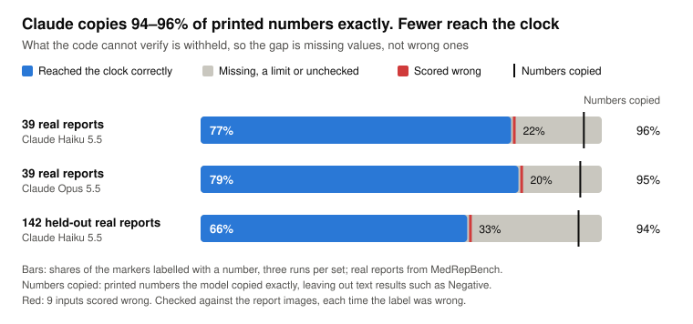
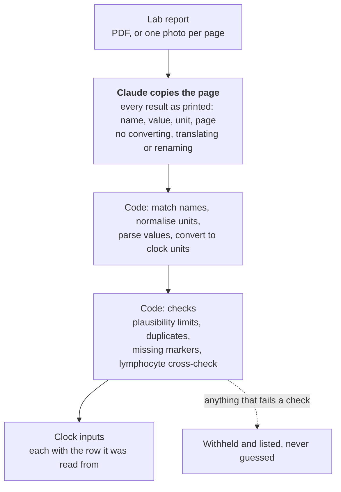

# lab2clock

[](https://github.com/SSAchijs/lab2clock/actions/workflows/ci.yml)

**Read a blood-test report with an LLM, and pass a biological age clock only numbers you can trust.**

A clock is only as good as the numbers fed into it: one missed conversion, CRP in mg/L where the clock expects mg/dL, adds 2.4 years to every user's PhenoAge.

`lab2clock` lets Claude copy the page and does everything else in tested code: names, units, arithmetic and sanity checks. Anything it cannot verify is withheld and listed, never guessed. It is built for lab reports from Asia, in SI units and often in Chinese.

On 142 real reports held back while I tuned the code on 39 others, 66% of markers reached the clock correctly, 27% went missing and 5% got through wrong, nearly all from urine tests printed under blood-marker names. The fixes they prompted block every wrong value seen, which uses that set up.

<picture>
  <source media="(prefers-color-scheme: dark)" srcset="docs/results-dark.svg">
  
</picture>

## Try it

No API key is needed for a report that has already been read:

```bash
uv sync
uv run lab2clock tests/data/stage1_example.json --age 52 --age-estimate
```

Each clock input comes back in the clock's unit, with the row it was read from:

```json
"c_reactive_protein": {
  "value": 0.03, "unit": "mg/dL", "censored": true, "limit": "<",
  "source": {"name": "hs-CRP", "value": "<0.3", "unit": "mg/L", "page": 2}
}
```

To read your own report, add `ANTHROPIC_API_KEY` to `.env` and pass a PDF, or one photo per page:

```bash
uv run lab2clock report.pdf --age 52 --age-estimate
uv run lab2clock page1.jpg page2.jpg --age 52
```

A report costs about $0.001 to read with Claude Haiku 5.5. `--age-estimate` adds a PhenoAge, labelled as an estimate, not a diagnosis: a range when an input was printed as a limit, like the demo's CRP, and none when an input is outside the range of 99% of adults, usually a unit slip.

## What the evaluation found

- **Copying the page is the easy part.** Claude Haiku 5.5 and Opus 5.5 copy 94–96% of printed numbers exactly; Haiku costs 1/30th as much. Most markers that go missing are lost in the data: the dataset blurs albumin's name on most reports (without albumin, 78% reach the clock on the held-out reports, 81% on the 39), many reports print no unit, and some rows are cropped.
- **Transcription accuracy hides the errors that matter.** The wrong values below were copied exactly or guessed, so a copying score cannot see them. My first end-to-end scorer missed the urine counts too: it checked labels with the code's own rules.
- **Holding out a set found what tuning hid.** The urine tests only appeared in the held-out reports.

Where wrong values reached the clock:

| Reports | What reached the clock | What blocks it now |
| --- | --- | --- |
| M18 | A white-cell count hidden under a pen line, which both models guessed | The cross-check of lymphocyte percent against count ÷ white cells now withholds both when they disagree |
| 8 held-out urine tests | Urine results under the blood markers' names, 白细胞 and 葡萄糖: counts of 0 to 204 cells per µL taken as blood counts, a "-" copied as 0, a "3+" read as 3. 20 values over three runs. | White-cell counts below 1,000 per µL are set aside as urine; a 0 is refused where no one living has 0; "3+" is not a number |

A value printed as a limit, such as CRP "<5.00", now reaches the clock marked as a limit, and one above a limit is withheld.

## How it works



## If you are building something similar

1. **Score what reaches the output, not what the model copied.** Count wrong and missing separately; only a wrong value hurts the user.
2. **Hold out a set before you start fixing,** and score each fix only on reports it was not made from. Once you fix from a held-out set, it is used up.
3. **Score with rules the code doesn't share.** A urine count read as a blood count looked right to a scorer that read labels the way the code did.

How the evaluation stays honest, more lessons and a map of the repository are in [METHODS.md](METHODS.md#at-a-glance).

## Limits

- **Small and narrow:** 181 real reports, all Chinese and mostly SI; US units are tested only on synthetic reports. The labels record what was printed, not the patient's true values.
- **The held-out set is used up:** fixes were made from it; [`results/frozen.md`](results/frozen.md) scores it with the code from before. A urine count of 1,000 per µL or more would still pass; knowing the panel a row is printed in is the real fix.
- **PhenoAge stands in for other clocks:** clinical clocks built on more routine markers, such as LinAge2, need a larger dictionary, but the design carries over.

## Next

- **Panel-aware reading:** have the model copy the panel heading above each row, such as 尿常规 (urinalysis), and flag values it cannot read, then compare that prompt with the current one on fresh reports.
- **Several reports per person:** merge a blood count from one lab with a metabolic panel from another.
- **Explanation layer:** a coach that explains the result, scored with the same harness on safety cases.

---

Data: NHANES 2017–2018 (public domain) and MedRepBench ([CC BY-NC 4.0](https://creativecommons.org/licenses/by-nc/4.0/); files derived from it keep that licence, see [METHODS.md](METHODS.md#license-of-the-derived-files)). Code: MIT.
