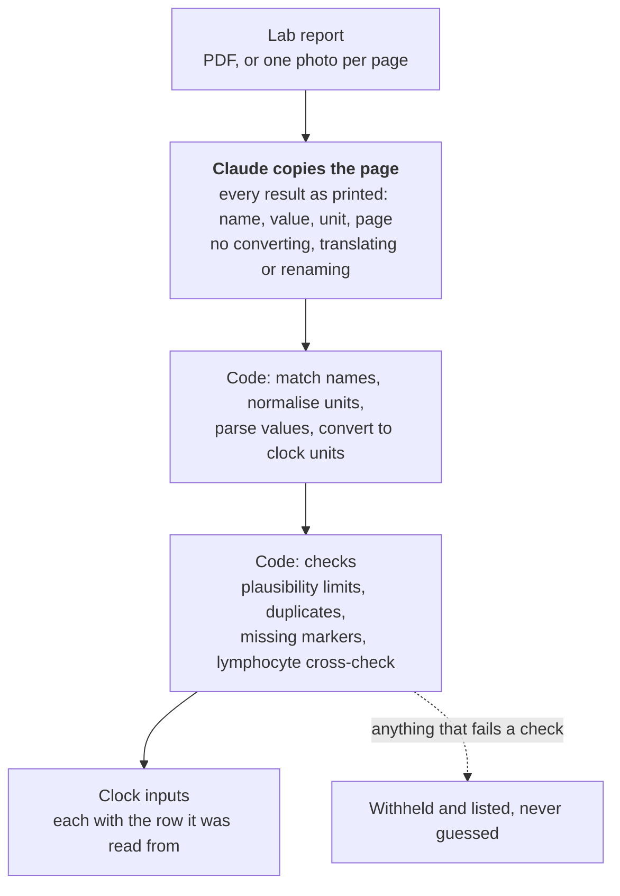

# lab2clock

[](https://github.com/SSAchijs/lab2clock/actions/workflows/ci.yml)

**Read a blood-test report with an LLM, and pass a biological age clock only numbers you can trust.**

A clock is only as good as the numbers fed into it, and lab reports print the same marker under different names, units and languages. One missed conversion, CRP in mg/L where the clock expects mg/dL, adds 2.4 years to every user's PhenoAge.

It is built for lab reports from Asia, where results come in SI units and often in Chinese: tested on 181 real Chinese reports, many of them phone photos, with US units covered on synthetic ones.

`lab2clock` lets Claude do the one thing only a model can do: copy the page. Matching names, converting units, arithmetic and sanity checks happen in tested code, and anything the code cannot verify is withheld and listed, never guessed. The output is the ten inputs of the PhenoAge clock ([Levine 2018](https://doi.org/10.18632/aging.101414)): age plus nine routine blood markers.

On 142 real lab reports held back while I tuned the code on 39 others, 66% of markers reached the clock correctly, 28% went missing, and 4% got through wrong, nearly all of them urine tests printed under blood-marker names. The fixes those reports prompted now block every one of them, which uses the held-out set up: any further change needs new reports to be tested on.

<picture>
  <source media="(prefers-color-scheme: dark)" srcset="docs/results-dark.svg">
  
</picture>

## Try it

No API key is needed to see the output. This runs the code stages on a report that has already been read:

```bash
uv sync
uv run lab2clock tests/data/stage1_example.json --age 52 --age-estimate
```

Each clock input comes back in the clock's unit, with the row it was read from:

```json
"c_reactive_protein": {
  "value": 0.03, "unit": "mg/dL", "censored": true, "limit": "<",
  "source": {"name": "hs-CRP", "value": "<0.3", "unit": "mg/L", "page": 2}
}
```

To read your own report, add `ANTHROPIC_API_KEY` to `.env` and pass a PDF, or one photo per page:

```bash
uv run lab2clock report.pdf --age 52 --age-estimate
uv run lab2clock page1.jpg page2.jpg --age 52
```

Claude Haiku 5.5 reads a report for about $0.001. The output lists every input that is missing and why. `--age-estimate` adds the PhenoAge the inputs give when all ten are present, labelled as a statistical estimate, not a diagnosis. When one was printed below a limit, as the demo's CRP is, it gives the range that limit allows rather than one number.

## What the evaluation found

**Copying the page is the easy part. Getting the right number to the clock is the hard part.**

Both Claude models copy 94–96% of printed numbers exactly; text results such as "Negative" are not counted. Yet on the held-out reports only 66% of markers reached the clock correctly. Most of the rest went missing for reasons in the data, not the reading:

- the dataset's anonymisation blurs the name of albumin on most reports, so it cannot be matched. Leaving albumin out, 78% reach the clock on the held-out reports with the current code, against 81% on the 39 it was tuned on;
- many reports print no unit, and the code refuses a value without one;
- rows are cropped, crossed out or skipped.

The wrong values that reached the clock came from two places:

| Reports | What reached the clock | What blocks it now |
| --- | --- | --- |
| M18 | A white-cell count hidden under a pen line, which both models guessed | The lymphocyte cross-check, which compares the printed lymphocyte percent with count ÷ white cells, caught the mismatch but withheld only the percent. It now withholds both. |
| 7 held-out urine tests | Urine results printed as 白细胞 (white cells) or 葡萄糖 (glucose), the names of the blood markers: counts of 0 to 17 cells per µL passed as blood counts; a "-" (negative) copied as 0; a "3+" read as 3 by a parsing rule I had just added. 18 values over three runs. | A white-cell count below 0.05 × 10⁹/L is refused as a urine count; a 0 is refused where no living person has 0; "3+" is not a number |

Neither route is fully closed: a heavy urine infection, over 50 cells per µL, would still pass the white-cell floor. The real fix is to know which panel a row is printed in (see [Next](#next)).

A value printed as a limit is not a value either. A standard CRP printed "<5.00 mg/L" used to reach the clock as if it were exactly 5.00, adding about 2.5 years to a healthy person, and ">5.0" became the same number. A value above a limit is now withheld; one below a limit reaches the clock marked as a limit, with a warning, and the age estimate becomes a range.

What this shows:

- **Transcription accuracy hides the errors that matter.** A "values copied correctly" score cannot see most of these: the urine counts were copied exactly, and the value under the pen line was a guess, not a misreading. Even my end-to-end scorer counted the urine counts as right, because it read the label with the same rules as the code. They were found by holding out a set, looking at the images, and judging a label by whether blood could have that value.
- **The model is not the bottleneck.** Claude Haiku 5.5 matched Claude Opus 5.5 within two points, at about 1/30th of the cost per report.
- **Failing safe works, but it has to be tested.** Withholding what cannot be verified turns most errors into gaps the output reports. The exceptions were found only by looking for them.

## How it works



The model only reads. Everything that can go wrong silently, from names in English and Chinese to units, arithmetic and sanity checks, is deterministic code with tests.

## If you are building something similar

1. **Score what reaches the output, not what the model copied.** Count wrong and missing separately; only a wrong value hurts the user.
2. **Keep the LLM out of the arithmetic.** Units, conversions and plausibility checks belong in code you can test. When a check fails, withhold the value.
3. **Hold out a set before you start fixing**, and score your fixes only on reports they were not made from. The held-out reports found urine tests that share names with blood markers, and a bug one of the fixes had introduced. Once you fix from a held-out set, it is used up.
4. **Don't let the scorer share the pipeline's assumptions.** The labels were converted with the code's own rules, so a urine count read as a blood count looked right to both. Look at the images: every "wrong" value the scorer still reports turned out to be the dataset's label, and one real error had been filed as "unverified", the class for a value whose label has no unit to check it against.
5. **Try the cheap model first.** Here it matched the expensive one.

## How the evaluation stays honest

- **Known truth first.** 25 synthetic reports are built from real [NHANES](https://www.cdc.gov/nchs/nhanes/) adults. They cover US, SI and mixed units, three layouts, Chinese, phone photos and planted errors. An "oracle", a reader that returns exactly what was printed, must score 100% before any model is scored, so this set checks the code. Both models also score 100% on it.
- **Real reports with checked labels.** The 181 real reports are from [MedRepBench](https://huggingface.co/datasets/MedRepBench/MedRepBench). I checked a random sample of 44 labels by hand against the images and found nothing wrong; a second pass by Claude then caught four unit errors I had missed, and I confirmed each against the image. 4 of 44 is 9%, so a disagreement with a label is not blamed on the model by default.
- **A frozen prompt and repeated reads.** The prompt is frozen and hashed. Each report is read three times, because neither model accepts a temperature setting.
- **Every change after seeing results is disclosed.** Each is listed with what prompted it in [METHODS.md](METHODS.md#changes-made-after-seeing-results).
- **Reproducible without a key.** Every raw response is committed, and CI fails if a fresh scoring run, this README's figure or the frozen held-out score differs from what is committed:

```bash
uv run python -m bench.score    # results/results.csv and results/summary.md
uv run python -m bench.figure   # docs/results-*.svg
uv run python -m bench.frozen   # results/frozen.md, the held-out set before fixes made from it
```

## Limits

- **Small and narrow.** 181 real reports, all Chinese and mostly in SI units. US units are tested only on synthetic reports.
- **No true values.** The real reports have labels of what was printed, not the patient's true values.
- **Urine rows under blood names.** The white-cell floor stops urine counts up to 50 cells per µL; a heavier infection would pass with a warning. Ruling it out needs to know which panel each row is printed in.
- **The held-out set is used up.** Four fixes were made from it, so its current score flatters the code. [`results/frozen.md`](results/frozen.md) scores it with the code as it was before it was read; new changes need new reports.
- **PhenoAge stands in for other clocks.** Clinical clocks built on more routine markers, such as LinAge2, need a larger dictionary and conversion table, but the design carries over.

## Next

- **Panel-aware reading:** have the model copy the panel heading above each row, such as 尿常规 (urinalysis), and say when a value is covered or cut off, so urine rows and guesses are refused at the source. A v1-versus-v2 prompt comparison on fresh reports would measure it.
- **Several reports per person:** merge a blood count from one lab and a metabolic panel from another into one set of inputs, checking that the dates are close enough to belong together.
- **Retake prompts:** ask for a new photo when a marker is missing or unreadable, instead of only listing it.
- **Explanation layer:** a coach that explains the result, scored with the same harness on safety cases such as emergencies, supplement claims and requests for a diagnosis.

## Repository

| Path | What it holds |
| --- | --- |
| [`lab2clock/`](lab2clock) | The tool: reading, name matching, units, checks, the command line |
| [`bench/`](bench) | The evaluation: synthetic reports, MedRepBench, model calls, scoring, the figure |
| [`prompts/`](prompts) | The frozen prompt |
| [`results/`](results) | Every model response, the scored results and the summary tables |
| [`METHODS.md`](METHODS.md) | Every step, number and decision in detail |

---

Data: NHANES 2017–2018 (public domain) and MedRepBench ([CC BY-NC 4.0](https://creativecommons.org/licenses/by-nc/4.0/); files derived from it keep that licence, see [METHODS.md](METHODS.md#license-of-the-derived-files)). Code: MIT.
