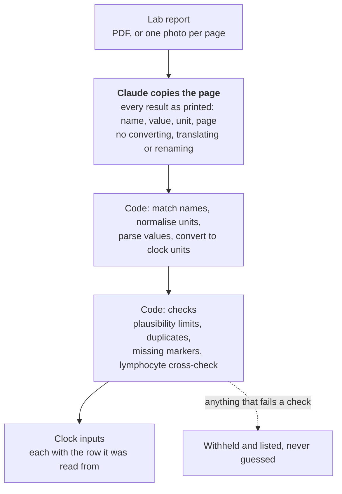

# lab2clock

[](https://github.com/SSAchijs/lab2clock/actions/workflows/ci.yml)

**Read a blood-test report with an LLM, and pass a biological age clock only numbers you can trust.**

`lab2clock` turns a lab report, a PDF or a phone photo, into the ten inputs of the PhenoAge clock ([Levine 2018](https://doi.org/10.18632/aging.101414)): age plus nine routine blood markers. Claude copies the page. Tested code matches the names, converts the units and checks the values, and anything it cannot verify is withheld rather than guessed.

It is also an evaluation of that design on 25 synthetic and 181 real lab reports:

<picture>
  <source media="(prefers-color-scheme: dark)" srcset="docs/results-dark.svg">
  
</picture>

## Try it

No API key is needed to see the output. This runs the code stages on a report that has already been read:

```bash
uv sync
uv run lab2clock tests/data/stage1_example.json --age 52 --age-estimate
```

Each clock input comes back in the clock's unit, with the row it was read from:

```json
"c_reactive_protein": {
  "value": 0.03, "unit": "mg/dL", "censored": true,
  "source": {"name": "hs-CRP", "value": "<0.3", "unit": "mg/L", "page": 2}
}
```

To read your own report, add `ANTHROPIC_API_KEY` to `.env` and pass a PDF, or one photo per page:

```bash
uv run lab2clock report.pdf --age 52 --age-estimate
uv run lab2clock page1.jpg page2.jpg --age 52
```

Claude Haiku 5.5 reads a report for about $0.001. The output lists every input that is missing and why. `--age-estimate` adds the PhenoAge the inputs give when all ten are present, labelled as a statistical estimate, not a diagnosis.

## What the evaluation found

**Copying the page is the easy part. Getting the right number to the clock is the hard part.**

Both Claude models copy about 95% of printed values exactly. On the first version of the code, only 73% of labelled markers on the 39 real reports reached the clock correctly. Fixing what the gap showed raised that to 78%. On 142 real reports held out until the fixes were done, 68% got through. Almost all the rest is in the data, not the reading:

- names blurred by the dataset's anonymisation;
- reports that print no unit;
- cropped, crossed-out or skipped rows.

Every value the code could not verify went missing rather than wrong, with three exceptions. Each one is a wrong number that reached the clock, and each is now blocked:

| Report | What reached the clock | What blocks it now |
| --- | --- | --- |
| M18 | A white-cell count hidden under a pen line, which both models guessed | The lymphocyte cross-check caught the mismatch but withheld the wrong value. It now withholds both. |
| H074 | A urine test's "-" (negative), copied as "0" and passed as a blood glucose of 0 | A value of exactly 0 is refused for markers no living person has at 0 |
| H118 | A urine "3+", read as the number 3 by a parsing rule I had just added | "3+" no longer counts as a number |

What this shows:

- **Transcription accuracy hides the errors that matter.** All three were invisible to a "values copied correctly" score, and the first version of my end-to-end scorer did not mark any of them wrong either. They were found by scoring what reaches the clock, holding out a set and looking at the images.
- **The model is not the bottleneck.** Claude Haiku 5.5 matched Claude Opus 5.5 within two points, at about 1/30th of the cost per report.
- **Failing safe works, but it has to be tested.** Withholding what cannot be verified turns most errors into gaps the output reports. The exceptions were found only by looking for them.

## How it works



The model does the one job only it can do, which is reading the page. Everything that can go wrong silently is deterministic, tested code. That covers names in English and Chinese, units, arithmetic and sanity checks. For example, most labs print CRP in mg/L while the clock takes mg/dL, and a missed conversion adds about 2.4 years to everyone's PhenoAge.

## If you are building something similar

1. **Score what reaches the output, not what the model copied.** Count wrong and missing separately; only a wrong value hurts the user.
2. **Keep the LLM out of the arithmetic.** Units, conversions and plausibility checks belong in code you can test. When a check fails, withhold the value.
3. **Hold out a set before you start fixing.** The held-out reports found urine tests that share names with blood markers, and a bug one of the fixes had introduced.
4. **Look at the images.** Every "wrong" value the scorer still reports turned out to be the dataset's label, not the pipeline. One real error had been scored "unverified".
5. **Try the cheap model first.** Here it matched the expensive one.

## How the evaluation stays honest

- **Known truth first.** 25 synthetic reports are built from real [NHANES](https://www.cdc.gov/nchs/nhanes/) adults. They cover US, SI and mixed units, three layouts, Chinese, phone photos and planted errors. A perfect "oracle" reader must score 100% before any model is scored.
- **Real reports with checked labels.** The 181 real reports are from [MedRepBench](https://huggingface.co/datasets/MedRepBench/MedRepBench). A person, not a model, hand-checked a random sample of the labels, so a misreading shared with Claude could not hide.
- **A frozen prompt and repeated reads.** The prompt is frozen and hashed. Each report is read three times, because neither model accepts a temperature setting.
- **Every change after seeing results is disclosed.** Each is listed with what prompted it in [METHODS.md](METHODS.md#changes-made-after-seeing-results).
- **Reproducible without a key.** Every raw response is committed, and CI fails if a fresh scoring run, or this README's figure, differs from what is committed:

```bash
uv run python -m bench.score    # results/results.csv and results/summary.md
uv run python -m bench.figure   # docs/results-*.svg
```

## Limits

- **Small and narrow.** 181 real reports, all Chinese and mostly in SI units. US units are tested only on synthetic reports.
- **No true values.** The real reports have labels of what was printed, not the patient's true values.
- **One known gap.** A urine white-cell count printed as a plain number per µL, under the blood marker's name, would pass with only a warning. No report here did this, but ruling it out needs a check of which specimen each row comes from.
- **PhenoAge stands in for other clocks.** Clinical clocks with more markers need a larger dictionary, but the design carries over.

## Next

- **Specimen check:** tell urine rows from blood rows before matching names.
- **Retake prompts:** ask for a new photo when a marker is missing or unreadable, instead of only listing it.
- **Explanation layer:** a coach that explains the result, scored with the same harness on safety cases such as emergencies, supplement claims and requests for a diagnosis.

## Repository

| Path | What it holds |
| --- | --- |
| [`lab2clock/`](lab2clock) | The tool: reading, name matching, units, checks, the command line |
| [`bench/`](bench) | The evaluation: synthetic reports, MedRepBench, model calls, scoring, the figure |
| [`prompts/`](prompts) | The frozen prompt |
| [`results/`](results) | Every model response, the scored results and the summary tables |
| [`METHODS.md`](METHODS.md) | Every step, number and decision in detail |

---

Data: NHANES 2017–2018 (public domain) and MedRepBench ([CC BY-NC 4.0](https://creativecommons.org/licenses/by-nc/4.0/); files derived from it keep that licence, see [METHODS.md](METHODS.md#license-of-the-derived-files)). Code: MIT.
